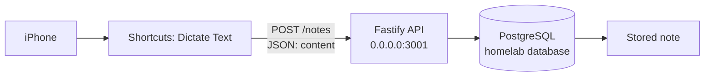

# Pocket Memory — Project Log

## 2026-09-14 — Phase 1: Text-first API

### Objective

Build and validate the first phase of Pocket Memory: a simple personal memory capture API that accepts text notes from an iPhone client and stores them in PostgreSQL. Phase 1 excludes hardware, voice transcription, AI classification, authentication, and search.

### Initial architecture

```text
iPhone
  ↓
HTTP API
  ↓
TypeScript / Node.js
  ↓
PostgreSQL
```

The API is intended to run on the existing Ubuntu homelab. Existing PostgreSQL and other homelab services were not reconfigured or otherwise modified.

### Technology choices

- **HTTP framework:** Fastify.
- **Database client:** `pg`.
- **Persistence:** parameterized SQL; no ORM.
- **Migrations:** ordered SQL files tracked in a `schema_migrations` table.
- **Validation:** Fastify JSON Schema validation.
- **Testing:** Vitest with Fastify in-process request injection and a mocked database boundary.
- **Configuration:** environment variables: `DATABASE_URL` is required; `HOST` and `PORT` are optional.

### Implementation completed

Created the initial TypeScript Node.js project structure and scripts for development, testing, type-checking, migration, building, and starting the API.

Implemented:

- `GET /health`
  - Executes `SELECT 1` against PostgreSQL.
  - Returns `{ "status": "ok", "database": "ok" }` when the API and database are available.
- `POST /notes`
  - Accepts a JSON body containing only `content`.
  - Rejects blank content and content longer than 10,000 characters with Fastify schema validation.
  - Creates a note and returns HTTP 201 with its identifier and timestamps.
- `GET /notes`
  - Returns all notes ordered by `created_at DESC, id DESC`.
  - Pagination is deferred from Phase 1.
- Centralized error handling.
- Graceful handling for `SIGINT` and `SIGTERM` to close the HTTP server and database pool.
- Project documentation, environment-variable example, and ignored local/build artifacts.

### Database schema and migration

Applied migration `001_create_notes.sql` to the existing `homelab` PostgreSQL database after confirming the target objects did not already exist.

Created Pocket Memory-only objects:

- `public.notes`
  - `id UUID PRIMARY KEY DEFAULT gen_random_uuid()`
  - `content TEXT NOT NULL` with a database check requiring non-blank trimmed content
  - `created_at TIMESTAMPTZ NOT NULL DEFAULT NOW()`
  - `updated_at TIMESTAMPTZ NOT NULL DEFAULT NOW()`
- `public.notes_created_at_idx` on `created_at DESC`
- `public.schema_migrations`
- Migration record for `001_create_notes.sql`

The existing `homelab.public.phone_contacts` table was observed but not modified.

The migration does not install or require `pgcrypto`. PostgreSQL 16 provides `gen_random_uuid()` natively through `pg_catalog` in this environment.

### Tests and validation performed

Completed the following checks successfully:

- Vitest suite: 1 test file passed; 5 tests passed; 0 failed.
  - Health success.
  - Valid note creation.
  - Blank note rejection.
  - Note listing.
  - Database-health failure response.
- TypeScript type-check: `tsc --noEmit` passed.
- Production build: `tsc` passed.
- Production API runtime validation on `127.0.0.1:3001`:
  - `GET /health` returned HTTP 200 and `{ "status": "ok", "database": "ok" }`.
  - Valid `POST /notes` returned HTTP 201.
  - Blank-content `POST /notes` returned HTTP 400.
  - `GET /notes` returned HTTP 200 and listed the created notes.
- Verified the API-created note `e703e6bd-1b38-49bf-8fd8-ad9683b252a4` directly in `homelab.public.notes`.
- Stopped the temporary API process after runtime validation.

### TypeScript error encountered and fix

The first type-check failed with two `TS18046` errors in the Fastify error handler because TypeScript treated the handler's `error` parameter as `unknown` when accessing `error.validation` and `error.message`.

The handler was updated to type the parameter as Fastify's exported `FastifyError`. The error response behavior was not changed. The subsequent type-check passed.

### npm and Node.js environment

The host has:

- Node.js `v22.22.1` at `/usr/bin/node`.
- Corepack `0.24.0`.
- No standalone `npm` executable on `PATH`.

Node.js is supplied by Ubuntu's APT-managed `nodejs` package from the Ubuntu Universe repository. The cached APT candidate matched the installed version. A non-privileged `apt update` could not refresh package metadata because the current user lacked permission to acquire the APT lock.

Corepack provided npm `12.0.2`, which warns that it supports Node.js `22.22.2` or later. The warning did not prevent dependency installation, tests, type-checking, the production build, migration, or runtime validation.

No system packages, Node.js versions, npm versions, PostgreSQL configuration, Docker service configuration, or unrelated database objects were changed. The environment was left unchanged because the project could be validated successfully and changing the APT-managed Node.js installation was outside the required implementation work.

### Warnings and vulnerabilities

- Corepack npm `12.0.2` emits a Node compatibility warning because the host uses Node.js `22.22.1`.
- npm blocked the `esbuild@0.28.2` postinstall script under its `allowScripts` policy. Vitest still ran successfully; `esbuild` is used transitively by both Vitest/Vite and `tsx`.
- `npm audit` reported two moderate findings for the same advisory affecting `vitest` and transitive `@vitest/mocker`: path traversal / arbitrary file read through redirect mocks. These are development test-tooling dependencies, not the Fastify or PostgreSQL production runtime dependencies. The reported fix requires the breaking major upgrade to Vitest 5. No audit remediation or dependency upgrade was performed.
- The environment example and setup documentation refer to copying `.env.example` to `.env`, but the application currently reads environment variables directly and does not load `.env` files itself.

### Current status

Phase 1 is implemented and validated against the existing `homelab` PostgreSQL database. The project builds, type-checks, and passes its complete test suite. The production build successfully handled the required endpoints and persisted a note in PostgreSQL.

### Next step

Decide and document the runtime configuration delivery method before deployment: inject `DATABASE_URL`, `HOST`, and `PORT` as process environment variables, or explicitly approve adding `.env` loading support. No change has been made to choose between those approaches.

## 2026-09-14 — Phase 2: iPhone voice capture

### Goal

Prove that Pocket Memory can capture a spoken memory from an iPhone and persist it.

### Final working flow

```text
iPhone
→ Shortcuts “Dictate Text”
→ POST /notes
→ Fastify API on port 3001
→ PostgreSQL
→ Stored note
```

### Architecture



### iPhone Shortcut configuration

The working Shortcut uses:

- **URL:** `http://192.168.0.49:3001/notes`
- **Method:** `POST`
- **Body:** JSON
- **Field:** `content`
- **Value:** output from Shortcuts **Dictate Text**

### Evidence

- Spoken input was successfully dictated on the iPhone.
- The API accepted the dictated text through `POST /notes`.
- PostgreSQL persisted the resulting note.

### Implementation and debugging record

- Host port 3000 was already occupied by Open WebUI. Pocket Memory's default and documented port were changed to 3001; Open WebUI was not modified.
- Pocket Memory initially had no `.env` file.
- `DATABASE_URL` was initially not loaded by the Node/tsx scripts. The `dev`, `migrate`, and `start` scripts were updated to use Node.js built-in `--env-file=.env` support. `tsx` is loaded through Node's `--import tsx` option so development watch mode runs correctly.
- PostgreSQL authentication initially failed because the credentials were incorrect. The connection details were corrected using the existing PostgreSQL configuration.
- The Shortcut initially used **Ask for Input** for text capture. It was replaced with **Dictate Text** to meet the voice-capture goal.

### Outcome

Phase 2 successfully demonstrated voice → API → PostgreSQL capture.

### Current status

Pocket Memory accepts dictated iPhone text on the local network at port 3001 and persists it as a note in PostgreSQL.

### Next step

Decide the next Phase scope for retrieval and organization, such as note search, AI-assisted classification, or a lightweight iPhone retrieval workflow.

## 2026-09-14 — Phase 3: AI memory enrichment

### Goal

Add optional AI-generated structure to an existing raw memory without changing the original captured content.

### Product decision

Raw memory is the source of truth. AI output is secondary metadata, not a replacement for capture. This preserves what the user actually said or typed, keeps uncertain enrichment separate, and allows enrichment to be retried or changed later without overwriting the memory.

### Data model

Added the `memory_metadata` table with a one-to-one `note_id` relationship to `notes`. It stores optional `type` and `summary`, JSON arrays for `people`, `topics`, `dates`, and `actions`, optional provider/model audit fields, and timestamps. The existing `notes` fields remain unchanged: `id`, `content`, `created_at`, and `updated_at`.

### Enrichment architecture

`POST /notes` stores the raw note first, then calls a provider-agnostic memory-enrichment service. The service expects structured JSON, validates the output before persistence, and stores valid metadata separately. The provider is selected using environment variables; the Phase 3 default is `disabled`. No external provider is required for local development or tests, and no provider SDK, queue, Redis, background job system, ORM, MCP integration, or Open WebUI integration was added.

`GET /notes/:id` returns the original note and any available metadata. `GET /notes` continues to return the raw note list.

### Failure behaviour

Provider errors, unavailable providers, invalid structured output, and metadata persistence errors do not undo or fail raw note creation. The API logs the enrichment failure, returns HTTP 201 for the stored note, and returns `metadata: null` when no metadata was saved.

### Example enrichment

For the capture “I need to book Luca's dentist appointment next Tuesday.”, valid optional metadata can identify a `task`, a concise summary, `Luca`, the `dentist` topic, the relative date “next Tuesday”, and the explicitly implied booking action. For a conversation or observation, `actions` and `dates` can remain empty and `type` may be `null` when no category is clear.

### Implementation decisions and trade-offs

- Metadata is stored separately to protect the source capture and avoid adding many nullable columns to `notes`.
- Metadata arrays use `JSONB` to retain a simple evolving schema in this phase.
- The response from `POST /notes` now distinguishes `note` from `metadata` explicitly.
- A configurable provider factory exists, but only the disabled provider is implemented. Selecting another provider currently fails enrichment safely rather than making the API unavailable.

### Tests and validation

Added coverage for raw note creation, successful enrichment, invalid AI output, provider failure, raw-note persistence when enrichment fails, `GET /notes/:id`, optional null/empty metadata fields, and preservation of original content.

- TypeScript type-check passed.
- Vitest suite passed: 1 test file and 9 tests passed with 0 failures.

### Current status

Phase 3 provides the data model and application boundary for optional AI enrichment while preserving raw memory as the source of truth. A real LLM provider remains intentionally unimplemented.

### Next step

Select and implement one LLM provider behind the existing provider abstraction, define its credentials through environment variables, and retain the current structured-output validation and best-effort failure behavior.

### First real provider implementation

Mac Ollama was selected as the first real enrichment provider. The homelab connectivity test to the Mac Ollama HTTP service succeeded. The provider uses Ollama's `/api/generate` API with model `qwen3-vl:8b` and requests JSON constrained to the Pocket Memory metadata schema.

The provider is configured with:

- `MEMORY_ENRICHMENT_PROVIDER=ollama`
- `MEMORY_ENRICHMENT_MODEL=qwen3-vl:8b`
- `MEMORY_ENRICHMENT_BASE_URL=http://192.168.0.226:11434`

The note route remains provider-independent. The Ollama provider sends the original captured content unchanged, receives model JSON, and passes it through the existing metadata validator before storage. The available `qwen3-vl:8b` service returns its generated JSON in Ollama's `thinking` field while leaving `response` empty, so the provider reads non-empty `response` output first and otherwise reads `thinking`. Successful metadata records the provider and model. Request failures, timeouts, non-success HTTP responses, invalid JSON, and invalid metadata are handled as best-effort enrichment failures: the raw note remains stored, the endpoint returns HTTP 201, and metadata remains `null`.

Provider tests use mocked Ollama HTTP responses and do not require the Mac or a running LLM. They cover valid structured enrichment, invalid model metadata, Ollama unavailability, and sending the raw capture unchanged to the provider.

Current limitations: no retry or durable background job mechanism exists. The configured Ollama model must be available on the Mac service. The provider records model and provider metadata but does not store the full raw model response.

### Asynchronous enrichment

Synchronous Qwen3-VL enrichment caused iPhone Shortcut requests to time out because `POST /notes` waited for the model response before returning. The request flow was changed from:

```text
POST /notes → store raw note → wait for Ollama → store metadata → HTTP 201
```

to:

```text
POST /notes → store raw note → HTTP 201
                         ↘ tracked in-process enrichment → Ollama → store metadata
```

An in-process background enrichment runner now starts work after the raw insert succeeds. It tracks pending tasks, catches and logs all enrichment errors to avoid unhandled promise rejections, and waits for tracked work during Fastify shutdown. A failed enrichment does not alter or delete the raw note.

A proper durable queue was deliberately deferred. This keeps the current homelab deployment simple and avoids adding Redis, a message broker, n8n, or a worker service before retry, durability, and throughput requirements are established. Consequently, enrichment can be skipped during shutdown and is not retried automatically.

Tests were updated to prove that `POST /notes` returns before an unresolved enrichment promise completes, that successful background enrichment eventually stores metadata, and that provider failures leave the raw note unchanged.

### Type-aware enrichment validation

A real Qwen3-VL response classified a Wi-Fi/request observation as a `task` while returning `summary: null` and empty arrays. The JSON was structurally valid but did not provide useful task metadata. Validation now includes semantic rules in addition to the existing strict output schema: `task`, `reminder`, and `idea` require a non-empty summary; `conversation`, `observation`, `note`, `other`, and `null` type may have no summary. All arrays remain valid when empty, and people, topics, dates, and actions remain optional.

The Ollama prompt now states these type-aware requirements and continues to instruct the model not to invent information. Responses that violate them fail enrichment safely, leaving the raw note unchanged with `metadata: null`. Tests cover valid tasks and reminders with summaries, rejected tasks without summaries, conversations without summaries, notes with empty optional fields, and existing invalid-output behavior.

### Retrieval interface implementation started

To support a lightweight, replaceable iPhone Shortcut interface, retrieval-oriented API work started with metadata-aware memory endpoints:

- `GET /memories` for filtered note+metadata retrieval
- `GET /memories/search` for query-driven lookup over captured content and enrichment fields

These endpoints preserve the source-of-truth note model and expose enrichment in a client-usable form without introducing a new web app, mobile app, or external service layer.

### Evidence-grounded synthesis improvement

To improve real-world enrichment quality, synthesis was upgraded from structure-only validation to evidence-grounded validation. Model output now includes evidence for classification, summary, and each extracted array item. Validation requires those evidence snippets to exist in the original raw note and to align positionally with extracted values.

The system now computes deterministic `quality_score` and `validation_flags` values and stores them with metadata for retrieval ranking and review. Type-aware summary rules remain in force (`task`, `reminder`, and `idea` must include non-empty summaries). Invalid or weakly grounded model output still fails safely with no raw-note mutation.
